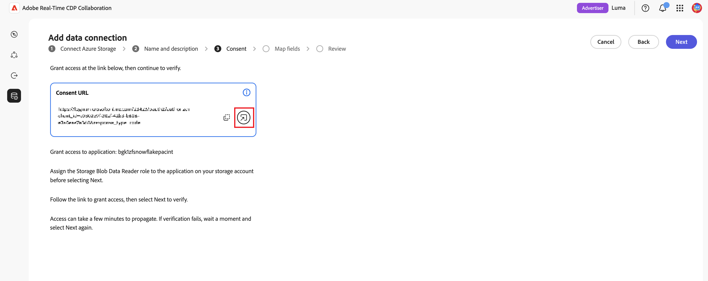
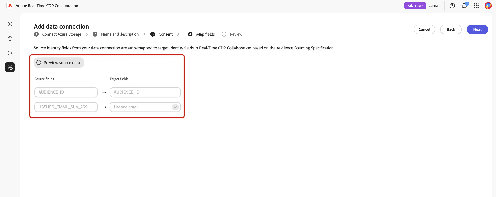

# Configura l&#39;archiviazione [!DNL Azure] per advertising exposure sourcing

Connetti il tuo account [!DNL Azure Data Lake Storage] o [!DNL Azure Blob Storage] ad Adobe Real-Time CDP Collaboration per rilevare i dati di esposizione pubblicitaria (ad log) di origine per la misurazione.

Il modulo di misurazione in Real-Time CDP Collaboration collega i dati di conversione degli inserzionisti con i registri di esposizione degli annunci dell’editore per fornire rapporti sulle campagne incentrati sulla privacy. Questo aggiunge un percorso self-service e senza codice per inserzionisti e editori. È possibile inserire i registri di esposizione (impression) degli annunci che si tengono già in [!DNL Azure] in Misurazione per l&#39;attribuzione, senza una dipendenza da Adobe Experience Platform. Connetti un account di archiviazione, un contenitore e un percorso, verifica che i dati rilevati corrispondano alle aspettative della misurazione dello schema dell’ad log e terminino in minuti.

I dati non vengono estratti al momento della connessione. L&#39;origine viene attivata quando si esegue un rapporto di misurazione. Per ridurre al minimo lo storage, Adobe elimina automaticamente i registri degli annunci di origine dopo un periodo di conservazione di 7 giorni.

Le regole di governance e gestione dei dati per i registri di annunci provenienti da [!DNL Azure] corrispondono alle regole applicabili ai dati provenienti da Adobe Experience Platform.

>[!NOTE]
>
>Questa guida tratta i **registri annunci** dell&#39;inserzionista e dell&#39;editore di sourcing (esposizioni pubblicitarie) dall&#39;archiviazione cloud. L’origine dei dati di conversione dall’archiviazione cloud sarà presto disponibile.

## Prerequisiti {#prerequisites}

Completa tutti gli elementi in questa sezione prima di avviare il flusso di lavoro di configurazione. Prima di seguire questa guida, devi aver completato l&#39;[onboarding e la configurazione dell&#39;account](./onboard-account.md).

### Accesso e autorizzazioni [!DNL Azure] {#azure-access-and-permissions}

L&#39;utente o l&#39;amministratore di [!DNL Azure] deve essere in grado di assegnare la mansione **[!DNL Storage Blob Data Reader]** nell&#39;account di archiviazione durante il passaggio **[!UICONTROL Consenso]** della procedura guidata. Consulta [Connetti registri annunci nella procedura guidata](#connect-adlogs).

### Preparare i dati del registro degli annunci {#prepare-adlog-data}

I file di registro degli annunci devono essere conformi allo [schema di registro degli annunci](#ad-log-schema) prima dell&#39;inizio dell&#39;origine. I requisiti principali includono:

* **Formato file:** solo CSV.
* **Intestazioni di colonna canoniche:** I file devono utilizzare le intestazioni di colonna canoniche definite nello [schema di registro annunci](#ad-log-schema). Questa versione non supporta il mapping per colonna o il mapping di schema automatizzato.
* **Campi obbligatori:** Tutti i campi obbligatori devono essere presenti, insieme ad almeno una chiave di corrispondenza.
* **Hash chiave di corrispondenza:** I valori hash chiave di corrispondenza devono essere caratteri esadecimali minuscoli SHA-256.
* **Coerenza colonna:** ogni file nel percorso configurato deve condividere un layout di colonna identico.
* **Sottocartelle:** i file devono trovarsi direttamente nel percorso specificato. Collaboration non attraversa le sottocartelle.

## Connettere i registri pubblicitari nella procedura guidata {#connect-adlogs}

Segui la procedura seguente per connettere i tuoi registri di annunci [!DNL Azure] da Collaboration.

1. Dall&#39;area di lavoro **[!UICONTROL Configurazione]**, selezionare **[!UICONTROL Dati di misurazione personali]**, quindi selezionare l&#39;icona di aggiunta e scegliere **[!UICONTROL Dati di misurazione]**.

   {zoomable="yes"}

2. Nel flusso di lavoro **[!UICONTROL Aggiungi dati di misurazione]**, seleziona **[!UICONTROL Esposizioni Advertising]** come tipo di dati di misurazione, quindi seleziona **[!UICONTROL Avanti]**.

   {zoomable="yes"}

3. Per importare i dati di misurazione, selezionare **[!UICONTROL Aggiungi una nuova connessione dati]**, quindi selezionare **[!UICONTROL Avanti]**.

   {zoomable="yes"}

4. Seleziona l&#39;origine dati per la nuova connessione dati: **[!UICONTROL Archiviazione BLOB Azure]** o **[!UICONTROL Archiviazione Data Lake Azure Gen 2]**. Seleziona **[!UICONTROL Avanti]**.

   {zoomable="yes"}

5. Verrà aperta la procedura guidata **[!UICONTROL Aggiungi connessione dati]**. Nel passaggio **[!UICONTROL Connetti archiviazione Azure]**, fornisci **[!UICONTROL Account di archiviazione]**, **[!UICONTROL Contenitore]**, **[!UICONTROL Percorso]** e **[!UICONTROL ID tenant]** in cui risiedono i file di registro degli annunci. Tutti i campi sono obbligatori e tutti i file nel percorso configurato vengono trattati come un unico set di dati.

   {zoomable="yes"}

6. Nel passaggio **[!UICONTROL Nome e descrizione]**, fornisci un **[!UICONTROL Nome connessione dati]** (obbligatorio) e una **[!UICONTROL Descrizione]** facoltativa per la connessione dati.

   {zoomable="yes"}

7. Nel passaggio **[!UICONTROL Consenso]**, seleziona l&#39;icona di avvio accanto all&#39;**[!UICONTROL URL di consenso]** per aprire la pagina di autorizzazione [!DNL Azure] e concedere l&#39;accesso all&#39;applicazione elencata. Assegna il ruolo **[!DNL Storage Blob Data Reader]** all&#39;applicazione nell&#39;account di archiviazione, quindi torna a Collaboration e seleziona **[!UICONTROL Avanti]** per verificare l&#39;accesso.

   >[!NOTE]
   >
   >La propagazione dell’assegnazione del ruolo può richiedere alcuni minuti. Se la verifica non riesce, attendi un attimo e seleziona di nuovo **[!UICONTROL Successivo]**.

   {zoomable="yes"}

8. Nel passaggio **[!UICONTROL Mappa campi]**, visualizza in anteprima le colonne rilevate per confermare che la procedura guidata ha letto i file corretti, quindi controlla lo [schema del registro annunci](#ad-log-schema), che elenca tutti i campi che la Misurazione comprende, quali campi sono obbligatori rispetto a facoltativi e quali colonne rilevate sono riconosciute come chiavi di identità/corrispondenza. Questo passaggio è una convalida di sola lettura: il sistema conferma che le intestazioni richieste siano presenti e ti blocca se manca un campo obbligatorio. In questa versione non è presente alcuna modifica per colonna.

   {zoomable="yes"}

9. Nel passaggio **[!UICONTROL Rivedi]**, rivedi e termina. La connessione viene visualizzata nell&#39;area dati di misurazione con il relativo stato, che rimane **in sospeso** fino a quando il primo report di misurazione non esegue i dati di origine.

## Funzionamento di ad log sourcing {#how-it-works}

L&#39;origine del registro annunci da [!DNL Azure] rispecchia il flusso di alto livello utilizzato per l&#39;origine del pubblico:

1. **Connessione archiviazione cloud:** hai configurato l&#39;accesso in sola lettura a un account di archiviazione o a un contenitore che contiene i registri degli annunci.
2. **Verifica e convalida dello schema:** il sistema convalida i file in base allo schema del registro annunci (controlli di cartelle, file e intestazioni obbligatorie; sola lettura).
3. **Mappatura campi:** i campi di identità di origine vengono mappati automaticamente ai campi canonici in base ai nomi delle colonne canoniche. Non è presente alcuna modifica manuale.
4. **Acquisizione e normalizzazione:** eventi sono normalizzati a una riga per esposizione. L&#39;origine del registro annunci viene avviata quando si esegue un rapporto di misurazione.

### Schema del registro degli annunci (formato CSV canonico) {#ad-log-schema}

I campi obbligatori devono essere presenti e deve essere presente almeno un campo contrassegnato **Chiave join (uno dei campi obbligatori)** nella tabella seguente. I valori hash chiave corrispondenti sono caratteri esadecimali minuscoli SHA-256.

| Campo | Tipo di dati | Obbligatorio | Descrizione |
| --- | --- | --- | --- |
| `EVENT_DATETIME` | Stringa (ISO 8601) | Obbligatorio | Timestamp dell’evento |
| `EVENT_ID` | Stringa | Facoltativo | ID univoco dell’evento |
| `EVENT_TYPE` | Stringa (enum) | Obbligatorio | Tipo di evento. Uno di `{impression, click}` |
| `HASHED_EMAIL_SHA_256` | Stringa (esadecimale a 64 caratteri) | Chiave di unione (uno dei valori richiesti) | Esadecimale SHA-256 minuscolo dell’e-mail |
| `HASHED_IPV4_SHA_256` | Stringa (esadecimale a 64 caratteri) | Chiave di unione (uno dei valori richiesti) | SHA-256 esadecimale minuscola di IPv4 |
| `DEVICE_ID` | Stringa (esadecimale a 64 caratteri) | Chiave di unione (uno dei valori richiesti) | ID dispositivo pubblicitario |
| `DEVICE_ID_TYPE` | Stringa (enum) | Facoltativo | Uno di `{idfa, gaid, aaid, rida, afai, msai, vida, lgudid, tifa}` |
| `ECID` | Stringa (esadecimale a 64 caratteri) | Chiave di unione (uno dei valori richiesti) | ECID basato su Demdex |
| `CUSTOM_ID` | Stringa | Facoltativo | ID persistente dell’editore/partner (ad esempio PPID, RampID, Core ID) |
| `ADVERTISER_ID` | Stringa | Obbligatorio | Identificatore univoco dell’inserzionista |
| `ADVERTISER_NAME` | Stringa | Facoltativo | Inserzionista/nome del marchio |
| `CAMPAIGN_ID` | Stringa | Obbligatorio | Identificatore campagna specifico per piattaforma |
| `CAMPAIGN_NAME` | Stringa | Facoltativo | Nome della campagna leggibile |
| `PLACEMENT_ID` | Stringa | Obbligatorio | Identificatore univoco del posizionamento |
| `PLACEMENT_NAME` | Stringa | Facoltativo | Nome posizionamento descrittivo |
| `CREATIVE_ID` | Stringa | Facoltativo | Identificatore univoco per la creatività dell’annuncio |
| `CREATIVE_NAME` | Stringa | Facoltativo | Nome creativo leggibile |
| `AUDIENCE_ID` | Stringa | Facoltativo | Identificatore del segmento di pubblico |
| `AUDIENCE_NAME` | Stringa | Facoltativo | Nome del pubblico leggibile |
| `DEVICE_TYPE` | Stringa (enum) | Facoltativo | Uno di `{mobile, desktop, tablet, ctv, dooh, car, in_store, other}` |
| `AD_FORMAT` | Stringa (enum) | Facoltativo | Uno di `{display, video, native, audio, search, commerce, dooh, other}` |
| `SITE_NAME` | Stringa | Facoltativo | Proprietà di rete/sito/app/editore in cui si è verificata l’impression |
| `TEST_GROUP` | Stringa | Facoltativo | Raggruppamento per studi di incremento, test/controllo, gruppi di controllo |
| `CUSTOM_DIM` | Stringa | Facoltativo | Dimensione editore aggiuntiva |

{style="table-layout:auto"}

>[!NOTE]
>
>`MATCH_KEY_TYPE` è incluso come campo facoltativo nello schema in modo che, nel tempo, più tipi di ID possano essere supportati in parallelo e la provenienza con chiave di corrispondenza (e-mail, telefono o CRM) possa essere mantenuta senza interrompere il contratto v1.

### Requisiti di convalida (v1) {#validation-requirements}

Il sistema convalida i dati di origine del registro degli annunci prima del completamento del flusso di lavoro di configurazione. Controlli di convalida:

* La cartella di origine deve contenere almeno un file.
* I file non possono essere vuoti.
* Le intestazioni di schema richieste devono essere presenti.
* I campi schema facoltativi possono essere omessi.
* I file contenenti solo i campi obbligatori sono validi.

Gli errori di convalida impediscono di procedere. Il sistema **non** convalida i tipi di dati, i valori dei campi, la completezza dei record, la qualità dei dati o la mappatura automatica dello schema. La convalida è limitata ai controlli di cartelle, file e intestazioni obbligatorie per questa versione iniziale.

## Limitazioni note {#known-limitations}

Tenere presenti i vincoli seguenti durante la configurazione e l&#39;utilizzo di [!DNL Azure] ad log sourcing:

* **Solo registri annunci:** Questa connessione genera registri annunci pubblicitari o editori (esposizioni pubblicitarie). I dati di conversione non sono ancora supportati.
* **Origini supportate:** [!DNL Azure Data Lake Storage] o [!DNL Azure Blob Storage] e [!DNL Google Cloud Storage].
* **Formato file:** solo CSV.
* **Intestazioni canoniche richieste:** non è presente alcuna mappatura per colonna e nessuna mappatura intelligente/automatizzata. I file devono utilizzare i nomi di colonna canonici.
* **Nessuna convalida del valore/tipo:** vengono convalidate solo le intestazioni di colonna obbligatorie. Inizialmente, potrebbero non essere presenti righe di dati.
* **Nessuna modifica di una connessione dopo la creazione:** Qualsiasi modifica, inclusa la modifica delle chiavi di corrispondenza attive, richiede la creazione di una nuova connessione.
* **Un layout per percorso:** Tutti i file nel percorso devono condividere un layout di colonna identico. I layout misti possono causare errori di sourcing parziali.
* **Sottocartelle non attraversate:** I file devono trovarsi direttamente nel percorso specificato.
* **Nessuna pianificazione o look-back durante l&#39;installazione:** L&#39;origine del registro annunci viene avviata quando si esegue un report di misurazione. Imposta il periodo di look-back quando configuri il rapporto.
* **Una connessione dati ad log:** Configurare una sola connessione dati ad log alla volta. I rapporti di misurazione utilizzano automaticamente la connessione configurata.

## Risoluzione dei problemi {#troubleshooting}

* **La connessione è in sospeso / nessun dato:** Previsto fino alla prima esecuzione del report di misurazione. Nessun dato viene originato al momento della connessione.
* **&quot;Nessun dato trovato&quot; al passaggio di origine:** La cartella è vuota. Aggiungi i file prima di procedere.
* **L&#39;anteprima non mostra colonne:** Il file è presente ma vuoto (nessuna intestazione o contenuto).
* **Impossibile superare la convalida:** Manca un&#39;intestazione di colonna obbligatoria. Conferma i campi obbligatori e almeno una chiave di corrispondenza è presente, utilizzando nomi canonici.
* **Colonne non riconosciute:** I nomi di colonna non canonici non vengono selezionati come campi noti. Rinominale nel formato canonico; in questa versione non è presente alcuna nuova mappatura.
* **Errore di determinazione origine dopo l&#39;installazione:** Verificare che l&#39;accesso in lettura di Adobe all&#39;account o al contenitore di archiviazione non sia stato modificato e che i file esistano ancora nel percorso configurato in formato canonico.
* **Intervallo date report non completamente coperto:** Ricorda la scadenza automatica dei dati di 7 giorni. I registri con più di 7 giorni potrebbero non essere disponibili per l’intervallo richiesto.

## Considerazioni sull’aggiornamento o la migrazione {#upgrade-migration}

* I clienti che hanno effettuato l’onboarding in precedenza tramite Experience Platform o la configurazione assistita da Adobe possono passare al percorso di archiviazione cloud self-service. I rapporti di misurazione e i flussi esistenti rimangono invariati.
* Le chiavi di corrispondenza presenti nei file di registro degli annunci devono essere abilitate per l’account Collaboration, come con audience sourcing.
* Le regole di governance e gestione dei dati corrispondono ai dati provenienti da Experience Platform.

## Passaggi successivi {#next-steps}

Al termine della determinazione dell’origine, i registri degli annunci sono disponibili per i rapporti di misurazione.

Per altri metodi di determinazione dell&#39;origine per l&#39;esposizione pubblicitaria, vedere [Configurare l&#39;archiviazione cloud Google per l&#39;origine per l&#39;esposizione pubblicitaria](./configure-gcs-adlog-sourcing.md).
