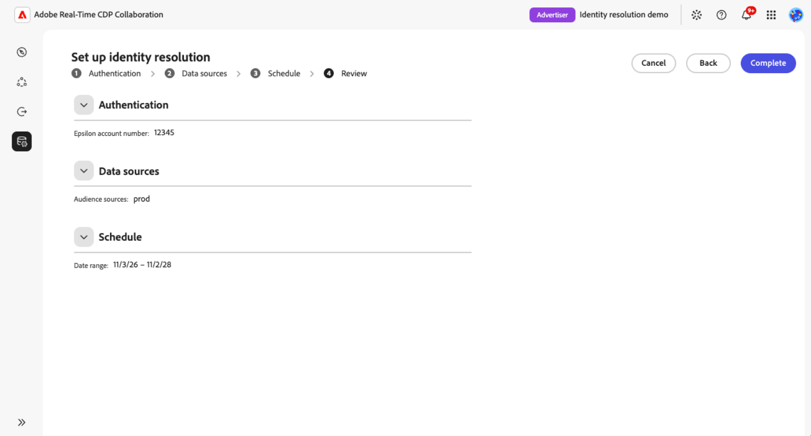

# Impostare e gestire la risoluzione delle identità

{{limited-availability-release-note}}

La risoluzione delle identità consente di identificare i clienti che hanno in comune con i collaboratori, anche quando le organizzazioni utilizzano identificatori diversi. Configura e gestisci la risoluzione delle identità con i provider di identità supportati in Real-Time CDP Collaboration, senza creare integrazioni personalizzate per ogni partner.

>[!NOTE]
>
>I passaggi e le schermate di questa guida utilizzano [!DNL Epsilon Core ID] come esempio. I requisiti e le opzioni disponibili possono variare a seconda del provider di identità.

>[!AVAILABILITY]
>
>All&#39;avvio, solo [!DNL Epsilon Core ID] è disponibile per la configurazione. La risoluzione dell’identità dell’ID core Epsilon è disponibile solo per gli account Real-Time CDP Collaboration con provisioning negli Stati Uniti.

## Prerequisiti {#prerequisites}

Prima di iniziare, si assicuri di avere:

* **Autorizzazioni di gestione account.** È necessario disporre delle autorizzazioni **[!UICONTROL Gestione account]** e **[!UICONTROL Gestione istanze Collaboration]**.
* **Almeno una connessione dati pubblico.** Per configurare la risoluzione identità è necessaria una connessione dati pubblico esistente. [Configura audience sourcing](./source-overview.md) se necessario. Le connessioni dati di misurazione non sono supportate.
* **Corrispondenza tra chiavi e campi supportata.** Ogni connessione dati del pubblico che intendi utilizzare per la risoluzione delle identità deve contenere campi supportati dal provider di identità. Per l’ID core Epsilon puoi utilizzare e-mail con hash, telefono con hash o nome combinato con l’indirizzo postale.

  Le chiavi di corrispondenza a livello di account, come e-mail con hash e telefono con hash, devono essere abilitate per l’account e mappate ai dati di pubblico. I campi del nome e dell’indirizzo postale vengono mappati durante la configurazione della connessione dati del pubblico e non richiedono l’abilitazione a livello di account.

  Se utilizzi il nome e l’indirizzo postale, mappa almeno un campo da ciascun gruppo:

  * **Nome:** Nome, cognome o nome completo.
  * **Indirizzo postale:** Indirizzo, città, CAP, stato o paese.

  I valori del nome e dell’indirizzo postale non sono sottoposti a hashing. Per istruzioni sull&#39;abilitazione delle chiavi di corrispondenza a livello di account, ad esempio e-mail con hash e telefono con hash, vedere [Modifica chiavi di corrispondenza](./onboard-account.md#edit-match-keys). Per mappare i campi delle chiavi di corrispondenza o dei nomi e degli indirizzi postali supportati ai dati del pubblico, vedi [Mappare i campi](./onboard-audiences.md#map-fields).
* **Numero account Epsilon.** Ottenere il numero di conto Epsilon dal proprio rappresentante commerciale Epsilon.

## Configurare la risoluzione delle identità {#configure-identity-resolution}

Seleziona un provider di identità per iniziare a configurare la risoluzione identità. In questo esempio di [!DNL Epsilon Core ID], effettuerai l&#39;autenticazione con il provider, selezionerai le connessioni dati del pubblico, imposterai un intervallo di date e rivederai la configurazione prima di confermare.

Per iniziare, seleziona **[!UICONTROL Configurazione]** nel menu di navigazione a sinistra, seguito dalla scheda **[!UICONTROL Risoluzione identità]** per visualizzare i provider di identità disponibili.

### Seleziona un provider di identità {#select-identity-provider}

Individua la scheda per il provider di identità, controlla l’area geografica supportata e le chiavi di corrispondenza. Selezionare **[!UICONTROL Configurazione]** per iniziare.

{zoomable="yes"}

Prima di avviare il flusso di lavoro di configurazione, Collaboration verifica la presenza di una connessione dati e di chiavi di corrispondenza compatibili. Se manca un requisito, viene visualizzata una finestra di dialogo per guidare il processo. Segui l’azione nella finestra di dialogo:

* **[!UICONTROL Connessione dati richiesta]:** Seleziona **[!UICONTROL Configura connessione dati]** per configurare una connessione dati pubblico. Vedere [Connettere un&#39;origine](./source-overview.md#connect-a-source).
* **[!UICONTROL Chiave di corrispondenza richiesta]:** Seleziona **[!UICONTROL Modifica chiavi di corrispondenza]** per abilitare una chiave supportata. Vedi [Modifica chiavi di corrispondenza](./onboard-account.md#edit-match-keys).

Se mancano entrambi, viene visualizzata per prima la finestra di dialogo della connessione dati. Dopo aver corretto i prerequisiti, tornare a **[!UICONTROL Risoluzione identità]** e selezionare nuovamente **[!UICONTROL Configurazione]**.

### Autenticazione con il provider di identità {#authenticate-with-provider}

Nel passaggio **[!UICONTROL Autentica]**, fornisci le informazioni richieste dal provider di identità. Per Epsilon Core ID, immettere il numero di account fornito dal proprio rappresentante Epsilon nel campo **[!UICONTROL Numero account Epsilon]**. Seleziona **[!UICONTROL Avanti]** per continuare.

{zoomable="yes"}

### Seleziona connessioni dati {#select-data-connections}

Quindi, scegli le connessioni dati del pubblico da utilizzare per la risoluzione delle identità. Questo determina quali dati sul pubblico verranno utilizzati per far corrispondere le identità dei clienti con il provider di identità. La risoluzione delle identità utilizza automaticamente gli identificatori supportati mappati in ogni connessione selezionata.
Quindi, scegli le connessioni dati del pubblico da utilizzare per la risoluzione delle identità. Le connessioni selezionate determinano i dati del pubblico e i campi mappati disponibili per la risoluzione delle identità.

La risoluzione dell’identità si applica a tutti i tipi di pubblico all’interno di ogni connessione dati selezionata, compresi quelli aggiunti in seguito. Al momento non è possibile selezionare singoli tipi di pubblico.

Se la connessione desiderata non è presente nell&#39;elenco, [configurare la connessione dati del pubblico](./source-overview.md) prima di continuare.

In **[!UICONTROL Origini dati]**, selezionare la casella di controllo per ogni connessione che si desidera includere in **[!UICONTROL Origini pubblico]**. Selezionare almeno una connessione. Seleziona **[!UICONTROL Avanti]** per continuare.

{zoomable="yes"}

### Impostare una pianificazione di risoluzione identità {#set-schedule}

Scegli le date di inizio e di fine per definire il periodo durante il quale Adobe aggiorna gli ID partner. La frequenza di aggiornamento è determinata dalle connessioni dati del pubblico selezionate, pertanto non puoi configurare una frequenza di aggiornamento separata per la risoluzione delle identità.

Nel passaggio **[!UICONTROL Pianifica]**, seleziona il controllo del calendario in **[!UICONTROL Intervallo date]** e scegli le date. Seleziona **[!UICONTROL Avanti]** per continuare.

{zoomable="yes"}

### Rivedi e conferma la configurazione {#review-and-confirm}

Nel passaggio **[!UICONTROL Rivedi]**, controlla i dettagli di autenticazione, le connessioni dati del pubblico selezionate e la pianificazione. Per apportare modifiche, seleziona **[!UICONTROL Modifica]** accanto alla sezione corrispondente.

Non è possibile modificare la configurazione dopo l&#39;installazione. Per apportare modifiche in un secondo momento, è necessario eliminarla e configurarla nuovamente. Una volta effettuata la selezione, selezionare **[!UICONTROL Conferma e pianifica]**.

{zoomable="yes"}

Una finestra di dialogo di conferma indica che la risoluzione dell’identità è stata configurata correttamente.

<!-- [Question: Does the first identity resolution run happen immediately after setup, or at the next scheduled audience data connection refresh?] -->

## Gestire la risoluzione delle identità {#manage-identity-resolution}

Dopo aver confermato la configurazione, si ritorna automaticamente alla scheda **[!UICONTROL Risoluzione identità]**, in cui è possibile visualizzare o eliminare la configurazione.

### Visualizza dettagli configurazione {#view-configuration-details}

Per rivedere la configurazione, seleziona **[!UICONTROL Visualizza dettagli]** sulla scheda del provider di identità configurato.

Esamina i dettagli di autenticazione, le connessioni dati del pubblico selezionate e l’intervallo di date. Puoi anche visualizzare le chiavi di corrispondenza visualizzate nei dettagli della configurazione, insieme allo stato della configurazione e alle informazioni sulla creazione e l’aggiornamento.

{zoomable="yes"}

### Modificare una configurazione esistente {#edit-configuration}

Non puoi modificare la configurazione di un Core ID dopo la configurazione. Per modificare il numero di account Epsilon, le connessioni dati selezionate o l&#39;intervallo di date, [eliminare la configurazione](#delete-configuration) e completare di nuovo il [flusso di lavoro di installazione](#configure-identity-resolution).

<!-- Question: Do other providers have the same limitation? -->

### Eliminare una configurazione di risoluzione identità {#delete-configuration}

Per eliminare una configurazione, passa a **[!UICONTROL Configurazione]** > **[!UICONTROL Risoluzione identità]** e seleziona **[!UICONTROL Elimina]** nella scheda del provider di identità configurato. Rivedi la finestra di dialogo di conferma, quindi seleziona **[!UICONTROL Elimina]** per confermare.

Se desideri utilizzare nuovamente questo provider di identità, devi [impostare una nuova configurazione](#configure-identity-resolution).

<!-- [UNVERIFIED: Does deletion affect previously resolved identifiers, future processing, or both? Confirm before publication.] -->

## Risoluzione dei problemi di configurazione {#troubleshoot}

Se non è possibile avviare l&#39;installazione perché manca una connessione dati o una chiave di corrispondenza, seguire le istruzioni in [Selezionare un provider di identità](#select-identity-provider).

Per l’ID core Epsilon, verifica quanto segue:

* **Non disponibile nella tua area geografica:** l&#39;ID di base Epsilon è disponibile solo per gli account Collaboration con provisioning negli Stati Uniti.
* **Numero account Epsilon non disponibile:** Contattare il proprio rappresentante Epsilon per ottenere il numero di account.
