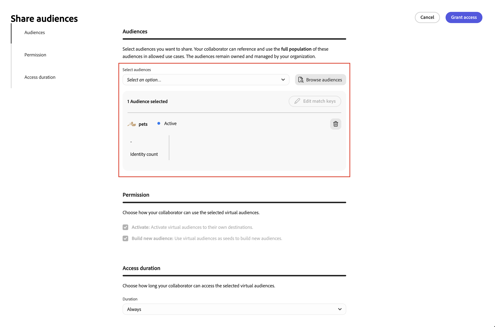

# Accesso al pubblico virtuale (concessioni di pubblico) per RMN {#virtual-audience-access}

Per condividere i tipi di pubblico con i partner connessi, utilizzare l&#39;accesso al pubblico virtuale in [!DNL Adobe Real-Time CDP Collaboration]. Una sovvenzione per il pubblico consente al partner di accedere all’intera popolazione del pubblico tramite un riferimento persistente. Quando concedi l’accesso, mantieni la proprietà e nessun dato sul pubblico viene spostato.

Per utilizzare un pubblico condiviso, individua il pubblico virtuale nel tuo inventario. Utilizza il pubblico per l’attivazione o la creazione di un pubblico di coorte all’interno delle autorizzazioni di concessione. Ad esempio, una rete di media retail (RMN) può concedere agli inserzionisti l’accesso per la creazione e l’attivazione di tipi di pubblico per coorte.

## Concetti di accesso al pubblico {#audience-access-concepts}

Per capire cosa condividi e come un partner può utilizzare il pubblico, rivedi i seguenti termini.

| Termine | Descrizione |
| --- | --- |
| Provider | L’organizzazione proprietaria del pubblico e che controlla l’accesso. |
| Destinatario | Il partner connesso che riceve l’accesso al pubblico. |
| Concedi | Accesso a un pubblico condiviso, inclusi gli utilizzi consentiti e la durata dell’accesso. |
| Pubblico virtuale | Riferimento permanente a un pubblico di proprietà del provider, disponibile nell’inventario dei destinatari. |
| Popolazione completa | Condivisione che consente l’accesso all’intera popolazione del pubblico. |
| Ambito della connessione | Accesso applicabile alla connessione tra il provider e il destinatario, anziché a un singolo progetto. |

{style="table-layout:auto"}

Per attivare un pubblico condiviso, è necessaria l’autorizzazione all’attivazione diretta.

L’accesso al pubblico virtuale si applica a una connessione. La condivisione all’interno di un progetto è un flusso di lavoro separato e non aggiunge tipi di pubblico virtuali all’inventario dei destinatari.

Per attivare i tipi di pubblico tramite un progetto di collaborazione esistente, vedere [Inviare e attivare i tipi di pubblico in un progetto](/help/guide/collaborate/activate.md).

## Prerequisiti {#prerequisites}

Prima di concedere o utilizzare l’accesso al pubblico virtuale, verifica di soddisfare i seguenti requisiti.

* Per le concessioni di pubblico virtuale, stabilisci una connessione [attiva con il tuo collaboratore](/help/guide/connect/establishing-connections.md).
* Se fornisci un pubblico, verifica che sia disponibile per la condivisione.
* Per confermare quali azioni sono disponibili, rivedi le autorizzazioni di concessione per i tipi di pubblico condivisi con te.

Nella finestra di dialogo **[!UICONTROL Condividi tipi di pubblico]** sono visualizzate le autorizzazioni seguenti. Entrambe le autorizzazioni sono selezionate e non sono disponibili per la modifica.

| Autorizzazione del pubblico | Uso consentito |
| --- | --- |
| Attivazione diretta | Attiva un pubblico condiviso in una destinazione senza un progetto quando il pubblico soddisfa i requisiti di attivazione. |
| [!UICONTROL Crea nuovo pubblico] | Utilizza un pubblico condiviso come input durante la creazione di tipi di pubblico. |

{style="table-layout:auto"}

## Condividere un pubblico {#share-an-audience}

Per consentire a un partner connesso di accedere a tipi di pubblico selezionati, concedi l’accesso a tutta la popolazione e imposta gli utilizzi e la durata consentiti. La concessione dell’accesso non attiva i tipi di pubblico.

Aprire innanzitutto l&#39;area di lavoro **[!UICONTROL Connect]** e la connessione del destinatario.

Quindi, seleziona **[!UICONTROL Accesso al pubblico]** e scegli l&#39;opzione per i tipi di pubblico che condividi con il partner.

L’opzione include il nome del partner. In questo esempio, selezionare **[!UICONTROL Per FrameSix Media]**.

Quindi, seleziona **[!UICONTROL Concedi l&#39;accesso]** per aprire la finestra di dialogo **[!UICONTROL Condividi pubblico]**.

In **[!UICONTROL Tipi di pubblico]**, scegli un pubblico tra **[!UICONTROL Seleziona tipi di pubblico]** oppure seleziona **[!UICONTROL Sfoglia tipi di pubblico]**.

Il pubblico selezionato viene visualizzato nella finestra di dialogo. La tua organizzazione mantiene la proprietà e la gestione dei tipi di pubblico.

Rivedi quindi le autorizzazioni visualizzate in **[!UICONTROL Autorizzazione]**. L’autorizzazione di attivazione diretta consente al partner di attivare i tipi di pubblico virtuali nelle proprie destinazioni. **[!UICONTROL Crea nuovo pubblico]** consente al partner di utilizzare i tipi di pubblico virtuali per creare nuovi tipi di pubblico. Entrambe le autorizzazioni sono selezionate e non sono disponibili per la modifica.

Quindi, scegli un&#39;opzione tra **[!UICONTROL Durata]** in **[!UICONTROL Durata accesso]** per impostare la durata di accesso del partner. Seleziona **[!UICONTROL Sempre]** per l&#39;accesso senza data di scadenza o specifica una data per l&#39;accesso con limite temporale.

Rivedi infine i tipi di pubblico, le autorizzazioni e la durata di accesso selezionati, quindi seleziona **[!UICONTROL Concedi l&#39;accesso]**.

La scheda **[!UICONTROL Accesso al pubblico]** elenca i tipi di pubblico condivisi con il relativo stato, conteggio delle identità, durata dell&#39;accesso, autorizzazioni e descrizione.

I tipi di pubblico condivisi vengono inoltre visualizzati nell’inventario dei destinatari come riferimenti virtuali. Mantenete la proprietà. Il destinatario può attivare separatamente un pubblico se la sovvenzione consente l’attivazione.

## Trovare e utilizzare tipi di pubblico condivisi {#find-and-use-shared-audiences}

In qualità di destinatario, trova i tipi di pubblico condivisi nella scheda **[!UICONTROL Accesso pubblico]** della connessione provider. Utilizza ogni pubblico all’interno delle autorizzazioni di concessione.

### Trovare tipi di pubblico condivisi {#find-shared-audiences}

Per trovare i tipi di pubblico condivisi da un provider e rivedere i relativi dettagli di accesso, apri la connessione al provider. Aprire innanzitutto l&#39;area di lavoro **[!UICONTROL Connect]** e la connessione al provider.

Quindi, seleziona **[!UICONTROL Accesso pubblico]** e scegli l&#39;opzione per i tipi di pubblico condivisi dal provider.

L&#39;opzione include il nome del provider. In questo esempio, selezionare **[!UICONTROL Da FrameSix Media]**.

Infine, controlla i tipi di pubblico condivisi e i relativi dettagli di accesso.

### Crea tipi di pubblico {#build-audiences}

Per creare un pubblico da un pubblico condiviso, è necessario disporre dell&#39;autorizzazione **[!UICONTROL Crea nuovo pubblico]**. Ad esempio, combina un pubblico condiviso con il tuo pubblico per crearne uno nuovo.

Il nuovo pubblico appartiene a te. Il provider mantiene la proprietà del pubblico sorgente.

### Attivare i tipi di pubblico condivisi {#activate-shared-audiences}

Per l’attivazione diretta di un pubblico virtuale, verifica che la sovvenzione soddisfi queste condizioni.

| Requisito | Condizione |
| --- | --- |
| Tipo di condivisione | Popolazione completa |
| Autorizzazione del pubblico | Disponi dell’autorizzazione di attivazione diretta per il pubblico. |
| Stato concessione | Attivo. L’accesso è indefinito o rientra nell’intervallo di date specificato. |

{style="table-layout:auto"}

Per inviare un pubblico idoneo a una destinazione, utilizzare la pagina **[!UICONTROL Attiva]**. Non hai bisogno di un progetto.

Per ulteriori informazioni, consulta [Attivare direttamente i tipi di pubblico (Beta)](/help/guide/destinations/direct-audience-activation.md).

Se un pubblico non soddisfa i requisiti, non puoi selezionarlo per l&#39;attivazione diretta. Collaboration controlla nuovamente l’idoneità a ogni esecuzione dell’attivazione pianificata.

## Gestire l’accesso al pubblico {#manage-audience-access}

In qualità di provider, puoi controllare la durata dell’accesso. Solo l&#39;utente può modificare la scadenza della concessione o revocare l&#39;accesso.

### Durata dell’accesso {#access-duration}

Scegli una durata di accesso al momento della creazione della sovvenzione.

| Durata | Comportamento |
| --- | --- |
| [!UICONTROL Sempre] | L&#39;accesso non ha scadenza automatica. Puoi revocare la sovvenzione. |
| Intervallo di date | L’accesso dura per l’intervallo di date specificato. Collaboration elabora ogni ora la scadenza. |

{style="table-layout:auto"}

Per estendere l’accesso, imposta una data di scadenza futura o modifica la durata in accesso indefinito. Entrambe le modifiche riattivano anche una sovvenzione scaduta.

### Scadenza accesso {#access-expiration}

Collaboration verifica ogni ora le sovvenzioni scadute. Quando Collaboration contrassegna una sovvenzione come scaduta, il destinatario perde l’accesso virtuale al pubblico.

### Revoca accesso {#revoke-access}

Per rimuovere immediatamente l&#39;accesso virtuale, revocare la concessione attiva o scaduta.

## Passaggi successivi {#next-steps}

Dopo aver concesso o ricevuto l&#39;accesso al pubblico, utilizza le seguenti guide per prepararti all&#39;attivazione o per gestire le connessioni dei collaboratori.

* [Configurare e gestire le destinazioni](/help/guide/destinations/manage-destinations.md)
* [Gestire le connessioni dei collaboratori](/help/guide/connect/manage-connections.md)
